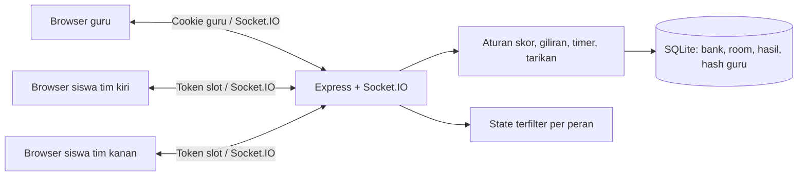

# Implementasi dan validasi

## Tahapan

| Tahap | Hasil |
|---|---|
| 1 | Analisis brief, struktur frontend/backend/tests/docs, Node 24 dan SQLite bawaan |
| 2 | Beranda, dashboard guru, kontrol, preview arena, navigasi responsif |
| 3 | Solo, kelompok 2–7 per sisi, identitas A–Z, warna, ikon, nama dan konfigurasi tersimpan |
| 4 | 24 karakter voxel SVG orisinal yang dapat dipilih guru/siswa |
| 5 | 130 soal Word, 11 bab, CRUD, filter, pencarian, ekspor JSON, acak pilihan |
| 6 | Deck unik, pasangan kesulitan, giliran, timer server, skor mentah dan tampilan |
| 7 | Tarikan simultan, ambang ±6, animasi tarik/bersiap/jatuh/selebrasi, konfeti, Web Audio |
| 8 | Room Socket.IO, siswa per slot, token reconnect, state privat, kontrol guru |
| 9 | Leaderboard live, hasil tersimpan SQLite, riwayat jawaban/anggota, main lagi, soal tambahan saat seri |
| 10 | Unit, integrasi HTTP/Socket.IO, browser multiperangkat, CRUD dan ukuran layar |

## Arsitektur

Server adalah sumber kebenaran. Browser tidak mengirim poin, waktu, posisi, atau status menang. Setiap jawaban mencakup ronde dan ID soal untuk menolak pesan terlambat. Siswa mendapat satu soal tim sendiri. Guru berhak melihat kedua sisi untuk penggunaan layar kelas. Teacher answer tidak memerlukan siswa online; ini mendukung perangkat kelas/proyektor.

Tarikan dihitung di akhir ronde untuk menghindari kemenangan sementara akibat urutan paket jaringan. Jawaban benar bernilai `+1` gaya, salah/timeout `−1`; posisi bertambah `gaya kiri − gaya kanan`. Batas gaya independen dari skor papan yang dijepit ke nol. Posisi tali dan perpindahan formasi di arena menggunakan nilai server yang sama.

Proses timer berjalan setiap 100 ms. Deadline epoch dikirim ke klien untuk tampilan; penerimaan jawaban diperiksa lagi terhadap waktu server. Ronde umpan balik berlangsung 2,5 detik. Countdown 3,3 detik memberi jeda awal. Pause mempertahankan sisa waktu fase, termasuk countdown dan feedback.

Database menyimpan snapshot room setelah transisi, jawaban, dan perubahan koneksi; history disimpan saat finish. Akun guru bertahan; sesi login dalam memori sengaja berakhir setelah restart. Room running dipulihkan paused. Snapshot tidak menyimpan proses aktif atau koneksi WebSocket.

## Pilihan produk dan batasan

- Satu server, satu akun guru, banyak room kelas; tidak dirancang sebagai layanan multi-sekolah.
- Tidak menggunakan Phaser karena SVG/CSS cukup untuk arena 2D dengan karakter voxel. Karakter merupakan ilustrasi blok berperspektif, bukan model 3D WebGL.
- Pertanyaan mengacu pada Word untuk Windows; beberapa fitur bervariasi per versi. Skenario soal melengkapi pengetahuan fitur dan shortcut.
- Kode room + slot dipakai sebagai undangan siswa. Guru perlu mengarahkan slot; pemain yang kehilangan token harus memakai layar guru atau room baru.
- Seluruh pemain mendapatkan giliran jika pertandingan mencapai jumlah soal penuh. Kemenangan garis dapat menyelesaikan pertandingan lebih awal.
- Bila bank pada kesulitan tertentu tidak cukup untuk jumlah soal yang diminta, pembuatan room/soal tambahan ditolak dengan pesan, tanpa memakai soal duplikat.
- History menampilkan 200 hasil terakhir dari database (hasil lebih lama tetap tersimpan); belum ada pagination/ekspor massal atau impor bank JSON. Ekspor bank dan hasil individual tersedia.
- Hosting publik, DNS, sertifikat, dan deployment tidak otomatis dibuat oleh push GitHub. Jalankan aplikasi pada hosting Node.js dengan volume data persisten.

## Validasi yang dijalankan

- `npm test`: aturan game serta HTTP/Socket.IO dengan SQLite sementara; pengujian memakai waktu terkontrol untuk menyelesaikan timer tanpa menunggu menit nyata.
- `npm run build`: bundel React/Vite produksi.
- `npm run test:browser`: Chromium nyata, konteks guru dan dua siswa terpisah, join, start, soal berbeda, jawaban terkunci, pause/resume, finish, hasil sinkron, CRUD soal, dan screenshot/overflow pada 1440, 768, 390 piksel.
- `npm audit --omit=dev --audit-level=high`: pemeriksaan dependensi runtime.

Hasil validasi terbaru dilaporkan pada penyerahan. CI mengulang pemeriksaan di mesin baru; keberhasilan lokal tidak menyatakan deployment publik atau keberhasilan CI yang belum dijalankan GitHub.

## Penyempurnaan layar pertandingan

Setelah START, layar fokus menampilkan arena, HUD, pertanyaan dua kolom, serta kontrol guru ringkas. Navigasi aplikasi dan footer disembunyikan selama bermain. Leaderboard live berada di halaman tersendiri melalui tombol Leaderboard; Kembali ke permainan membuka arena lagi tanpa memulai ulang atau menjeda timer. Pembaruan ronde tidak memindahkan guru keluar dari halaman leaderboard.

Mode kelompok mendukung 2–7 pemain per sisi, termasuk jumlah tim yang berbeda. Pemilihan slot siswa mencakup pemain ketujuh, validasi server menolak delapan pemain, dan rotasi ronde tetap memberi giliran kepada seluruh anggota. Ukuran karakter menyesuaikan untuk formasi enam atau tujuh pemain.
